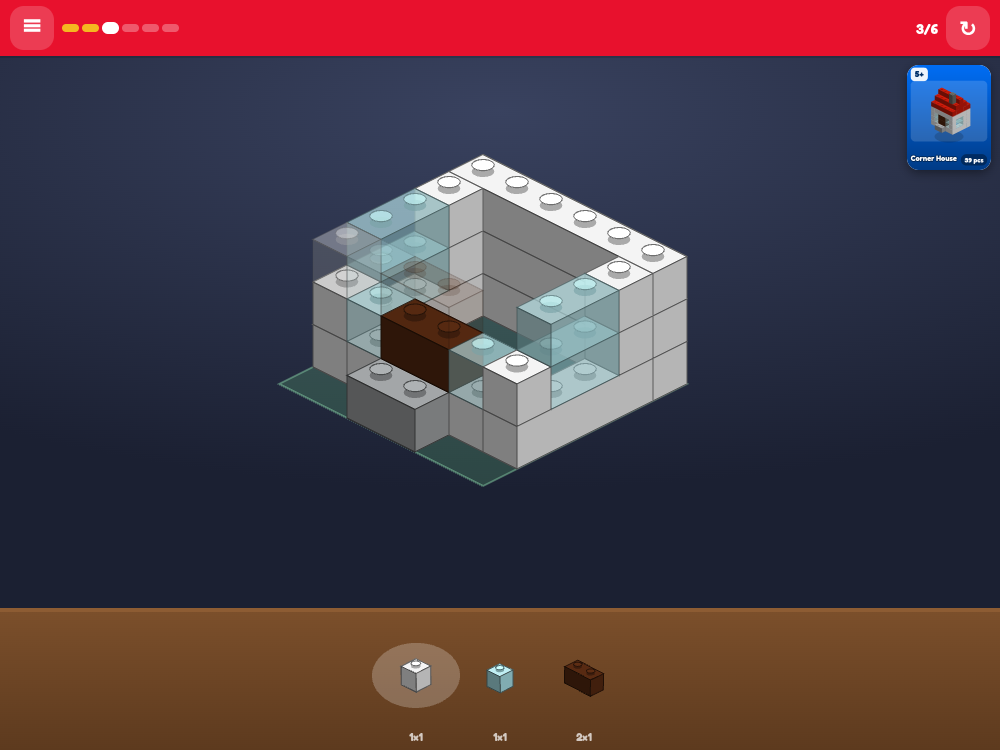
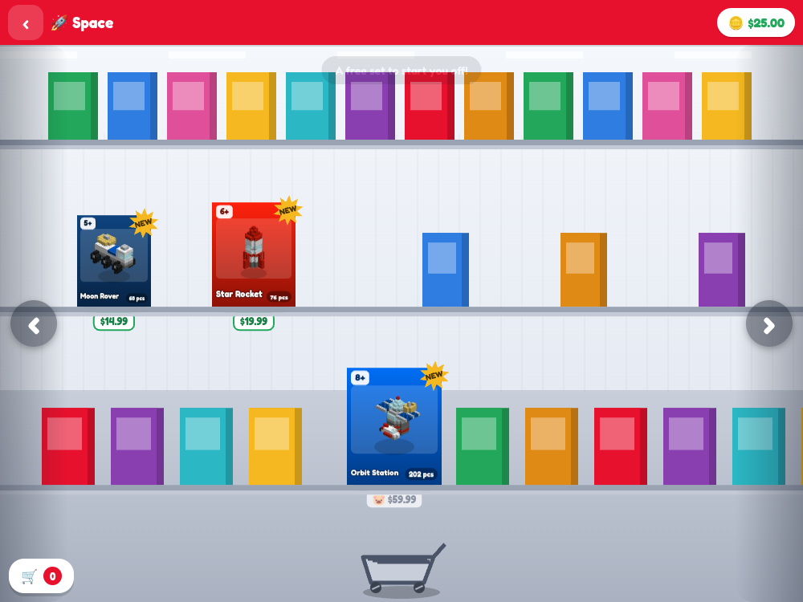
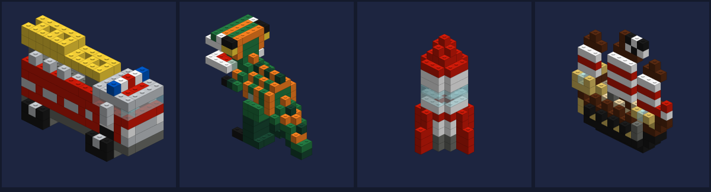

# Brick Mart

Shop the toy aisle of a big department store, then build what you bought, brick by brick. It's a
browser game for small children, played with taps, and every model is drawn with isometric vector
bricks. There are no image files.

**Play it:** https://brepre109.github.io/brick-mart/

| Building a set | The toy aisle |
| --- | --- |
|  |  |



## Features
- **31 sets in 10 themes** (City, Vehicles, Space, Castle, Pirates, Dino, Creatures, Hangout,
  Machines, Holiday), priced from $9.99 to $59.99 in play money.
- **A store to walk through.** There is a store map, aisles you push a cart along, boxes you can turn
  over, and a checkout belt that scans what you bought.
- **Step-by-step building.** A glowing ghost brick shows where the next piece goes. Any tap on the
  baseplate places it, so a toddler mashing the screen still finishes the set.
- **Built models live in your room.** Each one does a trick when tapped, and you can smash it and
  rebuild it.
- **A kid-sized economy.** You start with $25 and earn $1 per step, a $4 bonus the first time you
  finish a set, and daily pocket money. A set you can't afford goes on a wish list with a progress
  meter. Nothing is ever refused.
- All sound is synthesised with Web Audio. Progress is kept in one `localStorage` key.

## Quick start
No build step and no dependencies (Node is only needed for the tools and the test).

```bash
git clone https://github.com/brepre109/brick-mart.git
cd brick-mart
python3 -m http.server 8000      # or: npm start
# open http://localhost:8000
npm test                         # validates all 31 sets and checks catalog.js is in sync
```

## How it is built
| file | what it is |
| --- | --- |
| `index.html` | every screen, all the CSS, the DOM chrome |
| `iso.js` | isometric brick geometry: draw commands, the painter's sort, 90° rotation, hit tests |
| `catalog.js` | **generated** — every set baked into one file |
| `art.js` | box art, shelf thumbnails, model sprites, all cached |
| `synth.js` | every sound, generated; no audio files |
| `save.js` | the one localStorage key, `brickmart.v1` |
| `store.js` | store map, aisle, box view, cart, checkout |
| `build.js` | the build screen |
| `play.js` | the bedroom floor, smash and rebuild |
| `home.js` | bedroom, piggy bank, wish list, sticker book |
| `app.js` | boot, screen router, canvas sizing |
| `sets/*.json` | the set sources — see `SETS_SPEC.md` |
| `tools/` | packer, validator, catalogue baker, offline PNG previewer |

## Adding a set
1. Write `sets/<id>.json` following `SETS_SPEC.md`.
2. `node tools/validate.js sets/<id>.json` until it prints OK.
3. **Look at it**: `SHOT_CELL=430 node tools/shot.js out.png <id> --spin` renders the model from
   all four turntable angles to a PNG. Every set in this catalogue was revised against its own
   render, then shown to someone with no label who was asked what it was. Models authored blind
   do not read — roughly half of the first batch were unrecognisable.
4. `node tools/catalog.js` to rebake, then `./tools/stamp.sh`.

## Testing
`npm test` runs `tools/validate.js` on every set. It checks the format and the palette, and checks
that nothing floats: each connected island in a layer has to rest on the layer below, which is what
makes a model buildable brick by brick. It also checks that `catalog.js` matches `sets/`.
`tools/shot.js` renders any set to a PNG with a software rasteriser (`tools/png.js`), so you can
review models without opening a browser.

## Design notes
- **Isometric depth sorting.** A numeric depth key can't sort overlapping bricks correctly. Measured
  against a ray-cast, one misordered 805 of 23,725 overlapping pairs. `iso.js` builds a "must be
  drawn before" graph and sorts it topologically. The same ordering makes glass bricks look
  see-through.
- **Rotation** remaps the integer grid, `(x,y,w,d) -> (D-y-d, x, d, w)`, so every face stays
  axis-aligned and hit-testing keeps working. Only 90° turns are supported.
- **A brick is 1.25 × u tall**, measured against real brick proportions in this projection.
- **Models were checked with a blind test.** Each set was rendered to an unlabelled image and a
  reviewer with no context was asked what it showed. Weak models were rebuilt until they read
  correctly. 28 of 31 were identified on the first guess, and the rest were fixed.

## Tech stack
Vanilla JavaScript, Canvas 2D, Web Audio, and Node.js for the offline tools. It is served as static
files.

## Status / limitations
- Complete and playable, tuned for tablets and phones. It works with a mouse.
- There are only three sets per theme, and no in-game set editor. New sets are written as JSON by
  hand (see `SETS_SPEC.md`).
- The headless full-session playthrough rig used during development isn't included. The shipped
  test covers set validity only.
- "Brick Mart" is a generic made-up store. It isn't affiliated with any toy or brick brand.

## License
MIT © 2026 Brett Prejeant.
